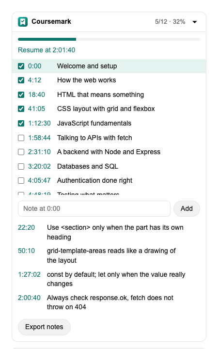
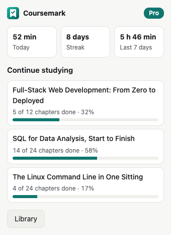
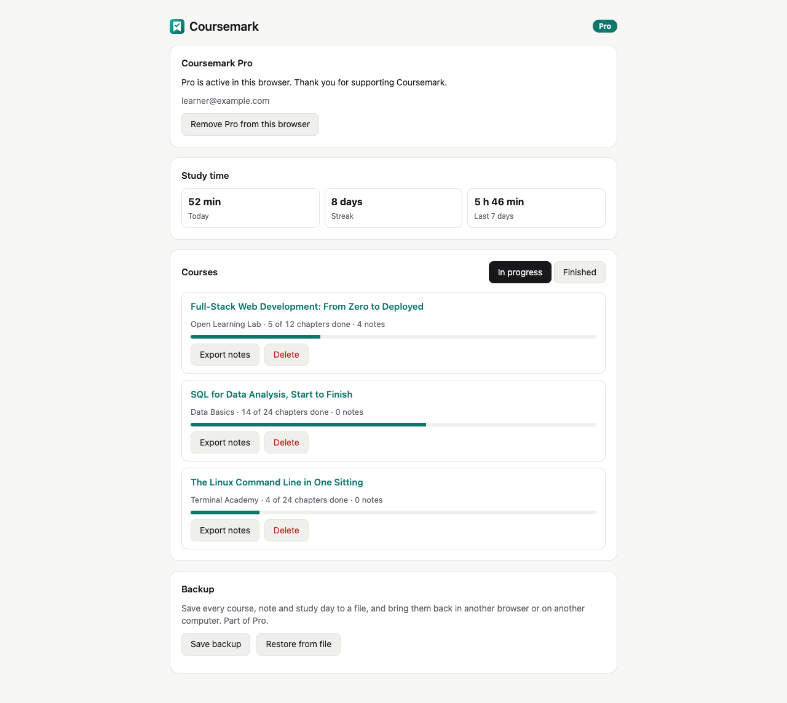

# Coursemark

Study long YouTube videos like a course. Coursemark puts the video's chapters beside it as a checklist
that ticks itself as you watch, keeps timestamped notes, and remembers where you stopped.

<p align="center">
  
  &nbsp;
  
</p>

Works in Chrome, Edge, Brave and other Chromium browsers, and in Firefox 140 or newer. English and
Arabic, following YouTube's light and dark themes.

## What it does

- **Chapters become a checklist.** Coursemark reads the chapter list from the video description, the
  same list YouTube uses for its own chapters. A video without one is split into parts of about ten
  minutes.
- **A chapter ticks itself once you have watched 90% of it.** Only real playback counts: skipping
  through, seeking past it or an ad playing does not. You can tick or untick any chapter by hand,
  and your choice stays.
- **Notes pinned to the moment.** A note takes the time from when you started typing, not when you
  pressed Enter. Click a note's time to jump back to it. Typing never triggers YouTube's keyboard
  shortcuts.
- **Pick up where you left off.** Reopen a course and a "Resume at 2:01:40" link is waiting.
- **Export to Markdown.** Chapters as a checklist and notes as links back into the video, ready for
  Obsidian, Notion or a README.

### Free and Pro

|                                                      | Free | Pro       |
| ---------------------------------------------------- | ---- | --------- |
| Chapter checklist, notes, resume, Markdown export    | yes  | yes       |
| Courses in progress at the same time                 | 3    | unlimited |
| Study time today and this week, streak of study days |      | yes       |
| Backup to a file and restore in another browser      |      | yes       |

Finished courses never count toward the free limit. Pro is a one-time purchase through
[Lemon Squeezy](https://www.lemonsqueezy.com), unlocked with the license key from the receipt email.

<p align="center"></p>

## Privacy

Everything stays in your browser's extension storage. Coursemark has no server, no analytics and no
account. The one network request it makes is to Lemon Squeezy's license API, and only if you enter a
Pro key: to activate it, to re-check it once a week, and to release it when you remove it. Firefox
asks for your consent before that request. Details in [PRIVACY.md](PRIVACY.md).

## Install

From the Chrome Web Store or Firefox Add-ons (links once the listings are live), or from source:

```sh
npm ci
npm run build     # writes dist/chrome, dist/firefox and a zip of each
```

- Chrome: open `chrome://extensions`, turn on Developer mode, "Load unpacked", choose `dist/chrome`.
- Firefox: open `about:debugging#/runtime/this-firefox`, "Load Temporary Add-on", choose
  `dist/firefox/manifest.json`.

## How it works

```text
src/
  content/bridge.js   runs in the page's own world: reads the current video's details from YouTube's
                      player and posts them to the extension
  content/loader.js   the content script; loads content/main.js as a module
  content/main.js     follows the <video> element, records what was watched, saves the course
  content/panel.js    the card beside the video, in a shadow root so YouTube's styles never mix in
  core/               the rules, with no browser APIs: chapters, watched spans, progress, plan
                      limits, license checks, stats, backup and Markdown
  lib/                storage, translations and helpers shared by the pages
  popup/  library/    the toolbar popup and the library page (the extension's options page)
```

Watched time is a list of merged `[start, end]` spans in seconds. A span is only recorded between
two `timeupdate` events of uninterrupted playback, so a seek, a pause or an ad leaves a gap rather
than a false "watched". YouTube is a single-page app; the bridge re-reads the player on every
in-page navigation and the panel re-attaches when YouTube rebuilds its columns.

There is no bundler. The files in `src/` are the files that ship; the build only copies them and
writes each browser's manifest.

## Development

```sh
npm ci
npm test              # unit tests for everything in core/
npm run test:e2e      # builds, then drives the real extension in Chromium on a local watch-page fixture
npm run lint          # Prettier, and Mozilla's add-on linter on the Firefox build
npm run screenshots   # regenerates docs/ and store/ images from the sample courses
```

The end-to-end tests answer `www.youtube.com` from `test/e2e/fixture.html` and a two-minute test
video, so they never depend on YouTube. Selling Pro and publishing to the stores are described in
[docs/selling.md](docs/selling.md).

## License

Source available under the [PolyForm Shield License 1.0.0](LICENSE.md): you may read, run, change and
share the code for any purpose except offering a product that competes with Coursemark.
